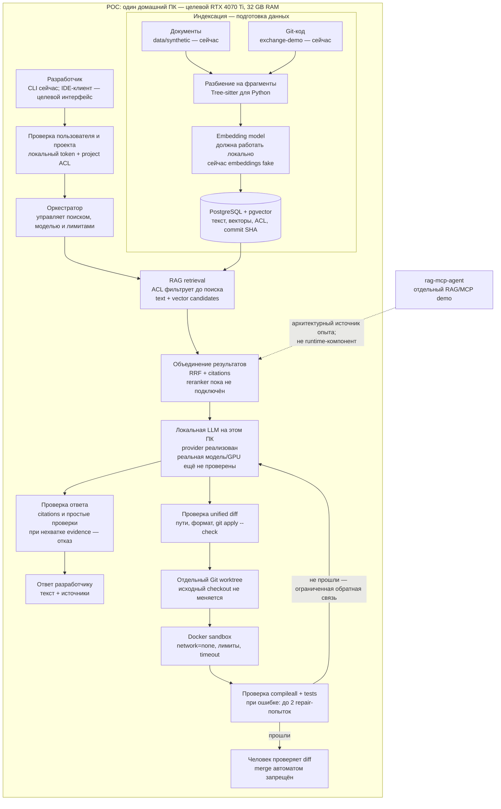

# Local Coding Copilot

Локальный ассистент для поиска по техническим документам и исходному коду, а также подготовки небольших проверяемых изменений.

## Как система должна работать

На POC все компоненты размещаются на одном домашнем ПК. Разработчик задаёт вопрос или coding-задачу; система находит только разрешённый контекст, передаёт его локальной модели и проверяет ответ или patch. Ни код, ни запросы не отправляются во внешние AI-сервисы.

### Что происходит на схеме

1. **Индексация:** документы и выбранный Git commit разбиваются на фрагменты. Локальная embedding-модель должна превратить их в векторы; сейчас это место занято fake embeddings. Фрагменты, текстовый индекс, права и версии хранятся в PostgreSQL/pgvector.
2. **Поиск:** ACL отсекает недоступные проекты до поиска. Текстовый и векторный поиск дают кандидатов; RRF объединяет их. Из найденных фрагментов строятся citations.
3. **Ответ:** локальная LLM получает вопрос и ограниченный найденный контекст. Проверка не доказывает каждое утверждение модели: она проверяет citations и некоторые простые свойства, а при недостатке evidence должна отказать.
4. **Изменение кода:** LLM предлагает только diff. Код проверяет diff, применяет его в отдельном worktree, запускает Docker-проверки без сети и возвращает diff человеку. При ошибке разрешено не больше двух повторных попыток.

`rag-mcp-agent` показан пунктиром, потому что это отдельный демонстрационный проект и источник архитектурных идей. Он не запускается внутри приложения. Целевой интерфейс — локальная IDE/оболочка, а не MCP; текущий coding POC запускается через CLI. Provider в имеющемся коде использует loopback-соединение с локальным inference server — это не внешний AI API.

### Домашний POC и enterprise-развёртывание

Схема выше — проверка на одном целевом ПК, а не схема на 100 пользователей. В enterprise те же логические блоки размещаются внутри закрытой сети: разработчики входят через SSO и project/repository ACL, LLM и embeddings обслуживаются внутренним GPU-пулом, запросы идут через очереди с квотами, а coding-проверки запускаются на отдельных изолированных workers. Производительность для 10 проектов и примерно 100 разработчиков пока не измерена и не обещается.

## Статус проекта

Это pre-enterprise POC, не готовый продукт для команды и не production-система.

- Работают document RAG, поиск по tracked Python-коду, project ACL, audit и coding loop с отдельным Git worktree и Docker-проверками.
- Код локального OpenAI-compatible LLM provider есть, но запуск реальной модели ещё не подтверждён.
- Embeddings пока fake, reranker не подключён.
- Coding benchmark содержит три синтетические задачи; он проверяет plumbing, а не качество модели на рабочих задачах.
- GPU, latency, offline и безопасность для enterprise-нагрузки ещё не измерены.

Цель POC — проверить архитектуру на синтетических данных и подготовить обоснованное решение о небольшом изолированном пилоте. Полное описание конечной системы — в [обзоре продукта и пайплайна](docs/PRODUCT_OVERVIEW.md).

## Принцип закрытого контура

Целевая система не отправляет исходный код, документы или запросы во внешние AI-сервисы. Модели, embeddings, БД и рабочие файлы размещаются внутри контролируемой инфраструктуры. Модель не получает прямой доступ к Git, базе данных, shell или production-секретам: её ответы проверяет управляющий сервис.

В текущем POC есть локальные HTTP/MCP-адаптеры для document/code queries и loopback HTTP-соединение с inference server. Это внутренние интерфейсы, не облачные провайдеры. Coding workflow сейчас запускается через CLI. Целевой способ доступа разработчиков нужно выбрать отдельно.

## Связанные репозитории

| Репозиторий | Для чего нужен | Отношение к этому проекту |
|---|---|---|
| [`local-coding-copilot`](https://github.com/subrosa5/local-coding-copilot) | Основной POC локального coding assistant: RAG, project ACL, orchestration, patch validation, sandbox и evaluation | Здесь развивается целевой продукт. Репозиторий public. |
| [`rag-mcp-agent`](https://github.com/subrosa5/rag-mcp-agent) | Отдельная демонстрация RAG/MCP: hybrid retrieval, tool use и evaluation | Источник опыта и отдельных архитектурных решений. Это отдельный проект, не сервисная или Git-зависимость local-coding-copilot. Репозиторий public. |
| [`exchange-demo`](https://github.com/subrosa5/exchange-demo) | Синтетический Python-код биржи с тестами и известными дефектами | Внешний учебный fixture для Code RAG, coding loop и benchmark. Не содержит код реальной биржи и не является частью приложения. Репозиторий public. |

Дополнительно, `data/synthetic/` внутри этого репозитория содержит демонстрационные документы для Document RAG. Внешние runtime-сервисы — PostgreSQL/pgvector и Docker; `rag-mcp-agent` и `exchange-demo` не являются устанавливаемыми Python-зависимостями.

## Документы

1. [Обзор продукта, полный пайплайн и целевая enterprise-архитектура](docs/PRODUCT_OVERVIEW.md) — начать отсюда.
2. [Компоненты и техническая архитектура](docs/ARCHITECTURE.md)
3. [Границы POC и конечные критерии](docs/SCOPE.md)
4. [Безопасность и threat model](docs/SECURITY.md)
5. [План оставшихся этапов](docs/DEVELOPMENT_PLAN.md)
6. [Оценка качества и benchmark](docs/EVALUATION.md)
7. [Чем POC отличается от enterprise-пилота](docs/PRODUCTION_GAP.md)
8. [Установка и запуск POC](docs/RUNBOOK.md)
9. [Сценарии будущей приёмки](docs/TESTER_GUIDE.md)

## Запуск POC

Инструкции и ограничения окружения находятся в [Runbook](docs/RUNBOOK.md). Для работы нужны Python 3.11+, Docker, PostgreSQL/pgvector и отдельный чистый checkout синтетического [`exchange-demo`](https://github.com/subrosa5/exchange-demo).

Все документы и код в демонстрации синтетические. Не добавляйте реальные репозитории, ключи, клиентские данные или production dumps.
