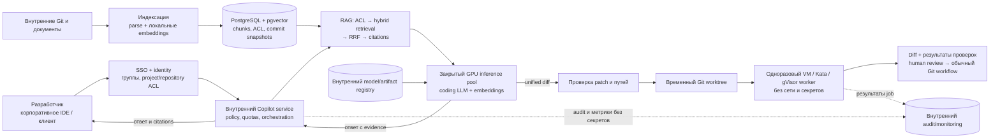

# Local Coding Copilot

Локальный ассистент для поиска по техническим документам и исходному коду, а также подготовки небольших проверяемых изменений.

## Целевая enterprise-архитектура

Это схема конечного продукта для закрытого контура примерно на 10 проектов и до 100 разработчиков. Она **не описывает текущую готовность**: POC пока запускается на одном узле, без SSO, внутреннего GPU-пула и enterprise sandbox. Подробности блоков и полный пайплайн — в [обзоре целевой архитектуры](docs/PRODUCT_OVERVIEW.md#как-должна-выглядеть-конечная-система).

Клиент обращается к внутреннему сервису компании; MCP и внешние AI-сервисы в этой архитектуре не используются. Все модели, данные и проверки остаются внутри закрытой сети. **Схема показывает целевое устройство, а не готовые функции POC.** Текущая домашняя схема и запуск описаны в [Runbook](docs/RUNBOOK.md), фактическая реализация — в [технической архитектуре](docs/ARCHITECTURE.md).

## Статус проекта

Это pre-enterprise POC, не готовый продукт для команды и не production-система.

- Работают document RAG, поиск по tracked Python-коду, project ACL, audit и coding loop с отдельным Git worktree и Docker-проверками.
- Код локального OpenAI-compatible LLM provider есть, но запуск реальной модели ещё не подтверждён.
- Embeddings пока fake, reranker не подключён.
- Coding benchmark содержит три синтетические задачи; он проверяет plumbing, а не качество модели на рабочих задачах.
- GPU, latency, offline и безопасность для enterprise-нагрузки ещё не измерены.

Цель POC — проверить архитектуру на синтетических данных и подготовить обоснованное решение о небольшом изолированном пилоте. Полное описание конечной системы — в [обзоре продукта и пайплайна](docs/PRODUCT_OVERVIEW.md).

## Принцип закрытого контура

Целевая система не отправляет исходный код, документы или запросы во внешние AI-сервисы. Модели, embeddings, БД и рабочие файлы размещаются внутри контролируемой инфраструктуры. Модель не получает прямой доступ к Git, базе данных, shell или production-секретам: её ответы проверяет управляющий сервис.

В текущем POC есть локальные HTTP/MCP-адаптеры для document/code queries и loopback HTTP-соединение с inference server. Это внутренние интерфейсы, не облачные провайдеры. Coding workflow сейчас запускается через CLI. Целевой способ доступа разработчиков нужно выбрать отдельно.

## Связанные репозитории

| Репозиторий | Для чего нужен | Отношение к этому проекту |
|---|---|---|
| [`local-coding-copilot`](https://github.com/subrosa5/local-coding-copilot) | Основной POC локального coding assistant: RAG, project ACL, orchestration, patch validation, sandbox и evaluation | Здесь развивается целевой продукт. Репозиторий public. |
| [`rag-mcp-agent`](https://github.com/subrosa5/rag-mcp-agent) | Отдельная демонстрация RAG/MCP: hybrid retrieval, tool use и evaluation | Источник опыта и отдельных архитектурных решений. Это отдельный проект, не сервисная или Git-зависимость local-coding-copilot. Репозиторий public. |
| [`exchange-demo`](https://github.com/subrosa5/exchange-demo) | Синтетический Python-код биржи с тестами и известными дефектами | Внешний учебный fixture для Code RAG, coding loop и benchmark. Не содержит код реальной биржи и не является частью приложения. Репозиторий public. |

Дополнительно, `data/synthetic/` внутри этого репозитория содержит демонстрационные документы для Document RAG. Внешние runtime-сервисы — PostgreSQL/pgvector и Docker; `rag-mcp-agent` и `exchange-demo` не являются устанавливаемыми Python-зависимостями.

## Документы

1. [Обзор продукта, полный пайплайн и целевая enterprise-архитектура](docs/PRODUCT_OVERVIEW.md) — начать отсюда.
2. [Компоненты и техническая архитектура](docs/ARCHITECTURE.md)
3. [Границы POC и конечные критерии](docs/SCOPE.md)
4. [Безопасность и threat model](docs/SECURITY.md)
5. [План оставшихся этапов](docs/DEVELOPMENT_PLAN.md)
6. [Оценка качества и benchmark](docs/EVALUATION.md)
7. [Чем POC отличается от enterprise-пилота](docs/PRODUCTION_GAP.md)
8. [Установка и запуск POC](docs/RUNBOOK.md)
9. [Сценарии будущей приёмки](docs/TESTER_GUIDE.md)

## Запуск POC

Инструкции и ограничения окружения находятся в [Runbook](docs/RUNBOOK.md). Для работы нужны Python 3.11+, Docker, PostgreSQL/pgvector и отдельный чистый checkout синтетического [`exchange-demo`](https://github.com/subrosa5/exchange-demo).

Все документы и код в демонстрации синтетические. Не добавляйте реальные репозитории, ключи, клиентские данные или production dumps.
