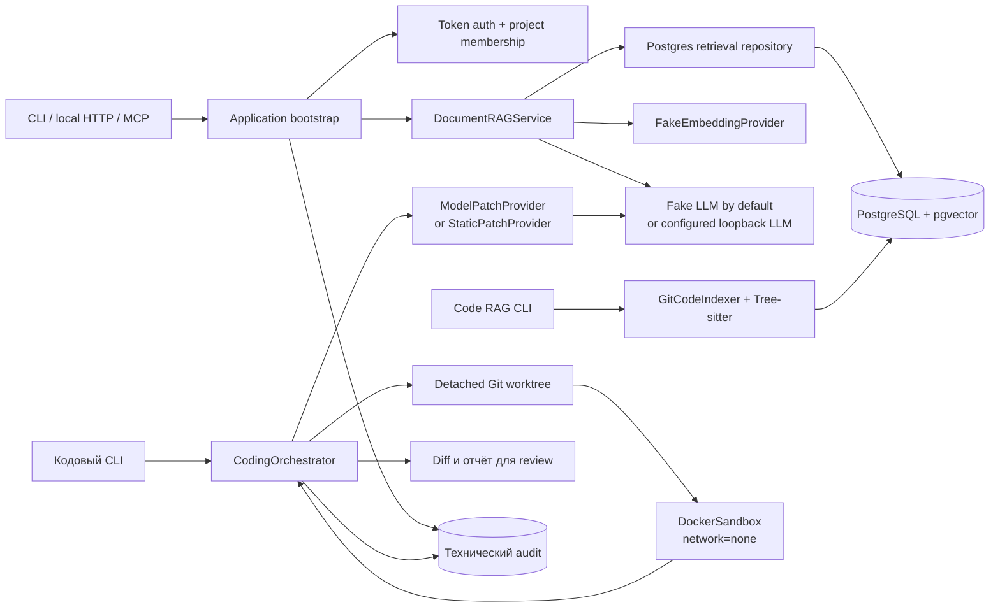

# Техническая архитектура

Для общего описания продукта и сценариев сначала прочитайте [PRODUCT_OVERVIEW.md](PRODUCT_OVERVIEW.md). Здесь зафиксированы конкретные компоненты текущего POC, связи между ними и отличия от целевого развёртывания.

## Архитектура текущего POC

На схеме опущены конкретные операции CLI, ошибки и метрики. Стрелка к модели не означает, что реальная модель уже проверена: без конфигурации используется fake LLM; embeddings остаются fake в любом режиме.

## Компоненты кода

| Зона | Реализация | Фактическая роль |
|---|---|---|
| Composition root | `src/local_coding_copilot/bootstrap.py` | Создаёт PostgreSQL repositories, auth, RAG services и providers |
| Auth | `src/local_coding_copilot/auth.py` | Проверяет локальный token и загружает роли/project membership |
| Document RAG | `src/local_coding_copilot/rag/` | Chunking, hybrid retrieval, context assembly, grounded response |
| Code RAG | `src/local_coding_copilot/code/` | Читает Git blobs, извлекает Python symbols и сохраняет commit-aware chunks |
| LLM providers | `src/local_coding_copilot/providers/` | Fake providers для CI и OpenAI-compatible loopback LLM client |
| Coding loop | `src/local_coding_copilot/coding/` | Patch provider, validation, worktree, sandbox и bounded repairs |
| Coding benchmark | `src/local_coding_copilot/coding_evaluation.py` | Сравнивает Base, RAG и RAG + test loop на текущих трёх задачах |
| Interfaces | `api.py`, `mcp_server.py`, `*_cli.py` | Локальные query endpoints/adapters и CLI; готового IDE UI нет |

## Document и code retrieval

1. `DocumentRAGService` получает question, project ID и authenticated principal.
2. Rate limiter применяется до embeddings и поиска.
3. PostgreSQL ограничивает кандидатов project membership в SQL, затем выполняет full-text и vector candidate search.
4. Reciprocal Rank Fusion объединяет результаты. Code RAG дополнительно ищет точные path/symbol/content совпадения.
5. В контекст модели передаются выбранные chunks. Для code citation содержит repository, path, symbol, строки и commit SHA.
6. `grounded` проверяет, что citations существуют и числа в ответе встречаются в процитированных фрагментах. Проверка не доказывает смысловую поддержку полного текста.

Code indexer работает с чистым checkout и зафиксированным Git tree. Сейчас он поддерживает Python, использует Tree-sitter и отклоняет tracked Python symlinks. Инкрементальный режим обновляет изменённые файлы и удаляет исчезнувшие chunks. Векторные embeddings пока fake, а reranker не подключён.

## Coding loop

`CodingOrchestrator` получает task, контекст и base commit. `ModelPatchProvider` запрашивает у выбранного LLM raw unified diff. До применения patch проверяются структура и пути; затем Git выполняет `apply --check` в отдельном detached worktree. `DockerSandbox` запускает `compileall` и `unittest` для этого worktree. При ошибке модель может получить ограниченные выводы проверки; допускается не более двух repair iterations. Итоговый worktree сохраняется для review. Merge API нет.

Sandbox в POC использует одноразовый Docker container, `network=none`, non-root пользователя, read-only root, writable worktree, лимиты памяти/CPU/PID и timeout. stdout/stderr считываются потоково с сохранением ограниченного хвоста. Это сокращает риск исчерпания памяти хоста через output, но не делает Docker эквивалентом VM или гарантией против container escape.

## Целевая enterprise-система

Текущая программа — одноузловой POC. Для закрытого пилота компоненты нужно разделить по зонам доверия:

1. **Вход пользователей:** корпоративный IDE/client и identity/SSO adapter.
2. **Control plane:** API/IPC boundary, authorization, project policy, quotas, orchestrator, audit.
3. **Data plane:** PostgreSQL/pgvector, версии документов, Git snapshots и локальные embedding/reranker models.
4. **Inference plane:** внутренний пул LLM workers с очередью и лимитами на пользователя/проект.
5. **Execution plane:** отдельные ephemeral VM/gVisor/Kata workers без сети и секретов для build/test.
6. **Review plane:** diff возвращается человеку; approval/merge выполняется существующими защищёнными Git-процессами.

Публичный интернет не нужен для этих потоков. Внутреннее соединение с inference service — это сетевой протокол внутри закрытой инфраструктуры, а не внешняя AI API. Если команда принципиально не хочет service API/MCP, пользовательский доступ можно реализовать клиентским приложением или IDE extension; кодовые границы auth, retrieval и orchestration всё равно должны оставаться в доверенном backend, а не переноситься в prompt.

Enterprise-компоненты на этом этапе — целевой план, а не наличие реализации: SSO, distributed quotas, очереди, GPU pool, multi-node HA, backup/restore, VM-grade sandbox, observability/alerting и масштабирование на 100 пользователей ещё не проверены.

## Хранение и журналирование

- **PostgreSQL/pgvector:** chunks, project metadata, tokens/membership, audit и состояние индексов.
- **Git:** исходный код и неизменяемая ссылка на base commit.
- **Локальное runtime-хранилище:** модели, временные worktrees и результаты benchmark; не коммитить в Git.
- **Audit:** технические outcomes, идентификаторы, hashes и ограниченные метаданные. Полные prompts, ответы и секреты по умолчанию не сохраняются.

Подробные настройки sandbox и угроз перечислены в [SECURITY.md](SECURITY.md); фактические пробелы пилота — в [PRODUCTION_GAP.md](PRODUCTION_GAP.md).
