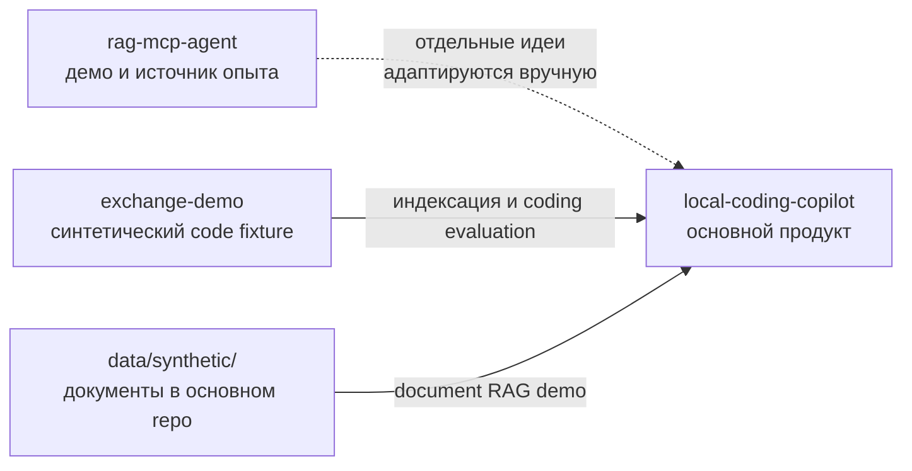

# Продукт и целевая архитектура

Этот документ объясняет систему для человека, который впервые знакомится с проектом. Он разделяет **то, что уже работает в POC**, и **то, что ещё предстоит построить для закрытого enterprise-пилота**.

## Идея в одном абзаце

Разработчик задаёт вопрос о внутреннем коде или документации либо просит подготовить небольшое изменение. Сервис проверяет права, находит разрешённый контекст, отправляет его локальной модели, проверяет ответ или patch программными правилами и запускает тесты в изолированной среде. Ответ сопровождается источниками, а изменение возвращается как diff для человеческого review. Модель не получает полномочий сама решать, какие проекты ей доступны, запускать произвольные команды на хосте или сливать код.

## Что именно означает «закрытый контур»

- Исходный код, документы, prompts, embeddings и ответы не покидают инфраструктуру компании.
- LLM и embedding-модели размещены внутри её сети; внешние AI API не используются.
- Сетевой egress запрещён или ограничен allowlist на уровне инфраструктуры, а не только инструкцией модели.
- Доступ к проектам проверяет backend по корпоративной identity и ACL.
- Модель считается недоверенным вычислительным компонентом. Ей передают только разрешённый контекст, а её результат проверяют до применения.
- Coding-задачи исполняются на временных workers без сетевого доступа и секретов.

«Закрытый контур» не означает, что между внутренними компонентами нет протоколов связи. Внутренний сервисный протокол допустим, если его трафик остаётся внутри контролируемой сети и защищён политиками компании. При этом целевой пользовательский интерфейс — например, IDE-плагин или локальный desktop agent — ещё нужно выбрать. Текущий POC содержит local HTTP/MCP адаптеры для запросов к RAG и CLI для coding loop; это не обязательные части будущего интерфейса.

## Как должна выглядеть конечная система

Ниже показана **целевая версия для закрытого enterprise-контура**: около 10 проектов и ориентир около 100 разработчиков. Это архитектурная цель, а не состав текущего POC и не обещание пропускной способности. Пользовательский путь не требует MCP или доступа к внешнему API. Клиентом предполагается корпоративное IDE-расширение или desktop-клиент; конкретный способ связи с внутренним сервисом выбирается при проектировании интеграции.

```mermaid
flowchart TB
  subgraph CLOSED[Закрытая сеть компании — без внешних AI-сервисов]
    DEV[Разработчики<br/>IDE / локальный клиент<br/>проектный контекст]

    subgraph CONTROL[Управляющий контур — доверенная бизнес-логика]
      CLIENT[Внутренний клиентский вход<br/>аутентификация запроса]
      IDP[Корпоративный SSO / identity<br/>группы и lifecycle доступа]
      POLICY[Policy service<br/>project + repository ACL<br/>квоты и лимиты]
      ORCH[Orchestrator<br/>план запроса, состояния,<br/>timeout и ограниченные retries]
      VALIDATE[Проверки результата<br/>citations / diff / разрешённые действия]
      CLIENT --> POLICY
      IDP --> POLICY
      POLICY --> ORCH
    end

    DEV --> CLIENT

    subgraph DATA[Контур данных и поиска]
      SOURCES[Разрешённые Git-репозитории<br/>документы и версии commit]
      INGEST[Контролируемая индексация<br/>проверка источника, разбор,<br/>секреты и метаданные]
      EMB[Внутренняя embedding-модель<br/>векторизация при индексации<br/>и поиске]
      STORE[(PostgreSQL + pgvector<br/>chunks, текстовый/векторный индекс,<br/>project ACL и commit metadata)]
      RETR[Retrieval<br/>ACL в SQL до кандидатов<br/>hybrid search → RRF → optional reranker]
      SOURCES --> INGEST --> EMB --> STORE
      STORE --> RETR
    end

    subgraph INFERENCE[Контур локальных моделей]
      QUEUE[Внутренняя очередь inference<br/>лимиты по проекту и приоритеты]
      GPU[GPU inference pool<br/>coding LLM + embeddings<br/>закреплённые версии моделей]
      REG[(Внутренний registry моделей<br/>проверенные файлы, hashes,<br/>версии и rollback)]
      REG --> GPU
      QUEUE --> GPU
    end

    subgraph EXEC[Контур выполнения кода — отдельная зона доверия]
      JOB[Изолированная coding job<br/>только выбранный проект и base commit]
      WT[Временный Git worktree<br/>исходный checkout read-only]
      RUNNER[Одноразовый sandbox worker<br/>VM / Kata / gVisor<br/>без сети, секретов и host mounts]
      CHECKS[Build, tests, linters<br/>лимиты времени и ресурсов]
      DIFF[Diff + результаты + evidence]
      JOB --> WT --> RUNNER --> CHECKS --> DIFF
    end

    REVIEW[Человеческий review<br/>защищённый Git workflow<br/>обычный CI и merge approvals]
    AUDIT[(Audit и operational metrics<br/>доступы, latency, исходы,<br/>без prompts/secrets по умолчанию)]

    ORCH -->|вопрос и разрешённые scopes| RETR
    RETR -->|только разрешённые фрагменты| ORCH
    ORCH -->|контекст и задача| QUEUE
    GPU -->|ответ или unified diff| VALIDATE
    VALIDATE -->|ответ с citations| CLIENT
    VALIDATE -->|валидированный patch| JOB
    DIFF --> REVIEW

    POLICY -. минимальные audit-события .-> AUDIT
    ORCH -. latency и outcome .-> AUDIT
    RUNNER -. результаты проверок .-> AUDIT
  end
```

### Как читать схему

- **Разработчик → внутренний клиент:** сотрудник задаёт вопрос или просит подготовить изменение из IDE/локального клиента. MCP и внешний AI API не являются пользовательским интерфейсом продукта.
- **Identity → policy → orchestrator:** сервис устанавливает пользователя, проверяет доступ к проекту/репозиторию, применяет квоты и только затем запускает поиск или coding job. Модель не принимает решений о правах.
- **Индексация:** документы и Git-версии поступают из разрешённых внутренних источников. Код разбирается, связывается с commit, индексируется локальной embedding-моделью и хранится с ACL. Индексация — отдельный контролируемый процесс, не действие модели.
- **RAG:** retrieval применяет ACL в запросе к данным, находит текстовые и векторные кандидаты, объединяет их через RRF и при доказанной пользе использует reranker. В контекст модели попадают только разрешённые фрагменты выбранной версии.
- **Inference:** coding LLM и embedding-модель обслуживаются внутренним GPU-пулом. Очереди, квоты, зафиксированные версии, hashes и rollback позволяют контролировать нагрузку и обновления. Модели не загружаются из интернета во время пользовательского запроса.
- **Coding loop:** модель возвращает unified diff. Валидатор ограничивает пути и формат, отдельный worktree изолирует изменение, одноразовый worker запускает проверки. Ограниченное число repair-попыток может получить только безопасную обратную связь.
- **Review:** человек получает diff, base commit и результаты проверок. Существующие защищённые Git-процессы выполняют approvals и merge; агент merge полномочий не имеет.
- **Audit:** фиксируются нужные для расследования и эксплуатации метаданные. Полные prompts, ответы и секреты не записываются по умолчанию.

На пилоте inference, БД, управляющие сервисы и runners размещаются раздельно по зонам доверия. Физические узлы, число GPU, replicas и способ оркестрации нельзя определить без измерений на целевых моделях и нагрузки. Это целевая схема для проектирования; текущий POC не реализует SSO, внутренний GPU-пул, registry, очереди или VM-grade sandbox.

## Компоненты и назначение

| Компонент | Что делает | Что важно для безопасности |
|---|---|---|
| Пользовательский клиент | Передаёт вопрос или задачу, показывает citations, diff и результаты | Не получает полномочия модели; использует корпоративную identity |
| Identity и policy service | Определяет пользователя, проект, роль и доступные репозитории | Проверяет доступ до retrieval; модель не может расширить ACL |
| Orchestrator | Управляет поиском, вызовами модели, patch loop и лимитами | Использует allowlist действий, quotas, timeouts и bounded retries |
| Document/code RAG | Находит фрагменты только из разрешённого проекта и нужной версии | ACL применяется в запросе к хранилищу до выдачи кандидатов |
| PostgreSQL + pgvector | Хранит chunks, индексы, project metadata и audit | Доступ к БД есть у backend, не у LLM или sandbox |
| Inference service | Локально выполняет LLM и embedding модели | Без внешних API; отдельные профили и лимиты на GPU очередь |
| Git/worktree manager | Фиксирует base commit и создаёт disposable копию для patch | Исходный checkout не меняется; base commit записывается в результате |
| Sandbox workers | Выполняют build, tests и разрешённые статические проверки | Нет сети, credentials и host mounts; лимиты ресурсов; временная среда |
| Audit/metrics | Фиксирует безопасные метаданные, задержки и исход проверки | Не записывает secrets и полный prompt/response без отдельной политики |
| Human reviewer | Проверяет diff и принимает решение в защищённом Git workflow | Только человек запускает обычное одобрение/merge; агент не имеет merge-полномочий |

## Пайплайн вопроса о документах или коде

1. Клиент отправляет вопрос и выбранный проект.
2. Backend аутентифицирует пользователя и проверяет membership. Название проекта в запросе само по себе не даёт доступ.
3. Retrieval ищет по разрешённым документам или зафиксированной версии репозитория. Для кода результат должен быть привязан к commit SHA.
4. Backend ограничивает контекст найденными фрагментами и передаёт его локальной модели как недоверенные данные.
5. Для ответа в строгом режиме проверяются citations и простые программно проверяемые свойства, например числовые значения. Если evidence недостаточно, система должна отказаться.
6. Клиент получает ответ, ссылки на источники и технический статус; audit сохраняет только согласованные метаданные.

Ни citations, ни prompt сами по себе не гарантируют истинность ответа. Для снижения галлюцинаций нужны хорошая модель, настоящие embeddings, оценка retrieval, независимый набор вопросов, ручная проверка утверждений и понятная политика отказа.

## Пайплайн coding-задачи

1. Backend проверяет роль, проект и право на конкретный repository.
2. Фиксируется base commit; retrieval подбирает небольшой контекст из той же версии кода.
3. Локальная coding-модель возвращает unified diff, а не команду для shell.
4. Валидатор отклоняет patch с запрещёнными путями, форматами или файлами и запускает `git apply --check`.
5. Patch применяется только к отдельному Git worktree. Исходный checkout не меняется.
6. Изолированный worker запускает compile/build, тесты и разрешённые linters. Логи, время и ресурсы ограничены.
7. Если проверка не прошла, orchestrator передаёт ограниченную обратную связь модели; число повторов строго ограничено.
8. Система возвращает diff, base commit, изменённые файлы, результаты проверок и отметку об изменённых тестах.
9. Разработчик проверяет изменение в обычном Git review. Автоматического merge в целевом продукте нет.

Успешные тесты — это evidence, но не доказательство корректности: модель может изменить или ослабить тесты. Для важных проектов нужны независимые acceptance tests и review изменённых тестовых файлов.

## Что уже есть в POC

| Возможность | Фактическое состояние |
|---|---|
| Документный поиск | PostgreSQL full-text + pgvector + RRF; тестовые документы синтетические |
| Code RAG | Только tracked Python; Tree-sitter symbols, Git commit citations и incremental indexing |
| Проектные права | Локальные admin/viewer tokens и project membership; это не SSO |
| LLM provider | OpenAI-compatible клиент для loopback endpoint; реальные модель и качество на ней не проверены |
| Embeddings | Fake hash-based vectors; семантический retrieval ими не подтверждён |
| Reranker | Интерфейс существует, в retrieval path не подключён |
| Coding workflow | CLI, Git worktree, raw diff validation, Docker compileall/unittest, максимум две repair iterations |
| Sandbox | Docker POC с `network=none`, лимитами и bounded output; не защита enterprise-уровня от container escape |
| Benchmark | Три синтетические задачи; пригоден для smoke проверки, не для оценки качества на реальном коде |
| Транспорт | Локальные HTTP/MCP RAG adapters и CLI; нет готового IDE UI или enterprise identity integration |
| Реальная эксплуатация | RTX 4070 Ti, latency, VRAM/RAM, offline и нагрузка не измерены |

Полный план оставшихся этапов находится в [DEVELOPMENT_PLAN.md](DEVELOPMENT_PLAN.md), а границы между POC и пилотом — в [PRODUCTION_GAP.md](PRODUCTION_GAP.md).

## Как масштабировать идею на 10 проектов и около 100 разработчиков

Это целевое направление, а не доказанная способность текущего POC.

- Доступы задаются через корпоративный SSO/группы и привязку пользователя к проектам и Git-репозиториям.
- Индексация идёт по проектам и commit snapshots; фоновые jobs ограничены по размеру, времени и очереди.
- Retrieval фильтрует данные по ACL до поиска. Ключи кэша включают проект, пользователя/политику и commit, чтобы не смешивать данные.
- Inference pool имеет очередь, per-project quotas, приоритеты интерактивных запросов и наблюдаемую загрузку GPU.
- Coding workers изолированы от inference и БД, получают только конкретную задачу/worktree и короткоживущие разрешённые артефакты.
- Audit и метрики поддерживают расследование, но не превращаются в хранилище полных prompts по умолчанию.
- Масштабирование подтверждается нагрузочным тестом на реалистичных типах запросов и задач, а не числом пользователей в архитектурной схеме.

## Что нужно доказать до пилота

1. На целевом железе работают выбранные coding и embedding модели; система продолжает работать без интернета.
2. Измерены качество retrieval и coding на расширенном, зафиксированном наборе с независимыми acceptance tests.
3. Установлены пороги отказа, latency, памяти, ресурсов и доли принятых человеком изменений.
4. Проверены cross-project ACL, prompt injection, секреты в логах, исчерпание ресурсов и очистка runners.
5. Тестировщики проходят сценарии без помощи автора; ошибки и остаточные риски задокументированы.
6. Отдельный security/architecture review принимает решение `go`, `conditional-go` или `no-go` для изолированного пилота.

До этих gate система остаётся POC на синтетических данных. Доступ к production-коду, реальным секретам и критичным системам не является частью текущего проекта.

## Как связаны репозитории

В работе есть три разных GitHub-репозитория; у каждого отдельная роль:

| Репозиторий | Роль | Нужен для запуска основного приложения? | Данные и доступ |
|---|---|---:|---|
| [`local-coding-copilot`](https://github.com/subrosa5/local-coding-copilot) | Основной проект: backend POC, document/code RAG, авторизация, coding orchestration, sandbox и оценки | Да — это само приложение | Код проекта и синтетические fixtures; public |
| [`rag-mcp-agent`](https://github.com/subrosa5/rag-mcp-agent) | Отдельный RAG/MCP демонстрационный агент. В нём показывались hybrid retrieval, tool use и evaluation; оттуда берётся опыт и могут адаптироваться отдельные проверенные подходы | Нет — не запускается как часть local-coding-copilot и не вызывается им | Отдельный public demo repository; это не основная система для enterprise-контура |
| [`exchange-demo`](https://github.com/subrosa5/exchange-demo) | Синтетическая биржевая codebase для индексации, проверки Python Code RAG и подготовки coding задач | Нет для обычного старта приложения; нужен для повторения текущих code/coding demo и benchmark | Искусственный код и тесты, не код биржи; public |

Связь между проектами можно представить так:

Стрелка от `rag-mcp-agent` означает перенос проверенных идей отдельными изменениями, а не runtime-вызов, Git submodule или автоматическое копирование всего проекта. Для закрытого продукта внешней зависимостью от него быть не должно. `exchange-demo` — тестовая codebase, которую индексирует приложение; это не библиотека и не production-репозиторий.
